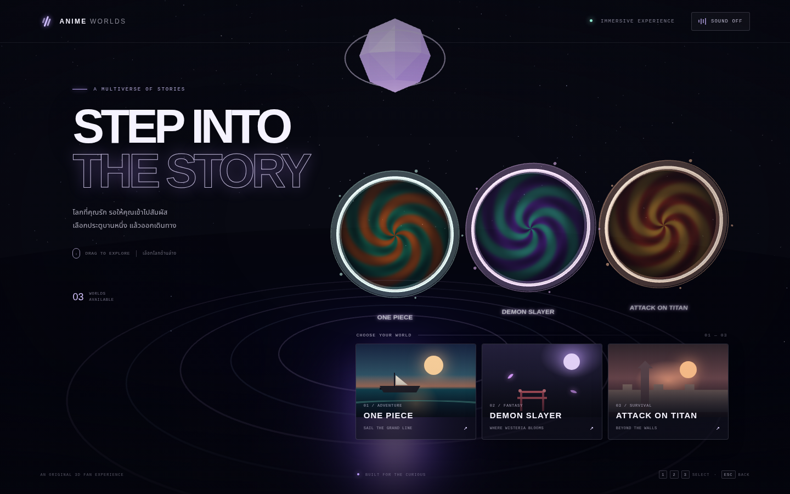
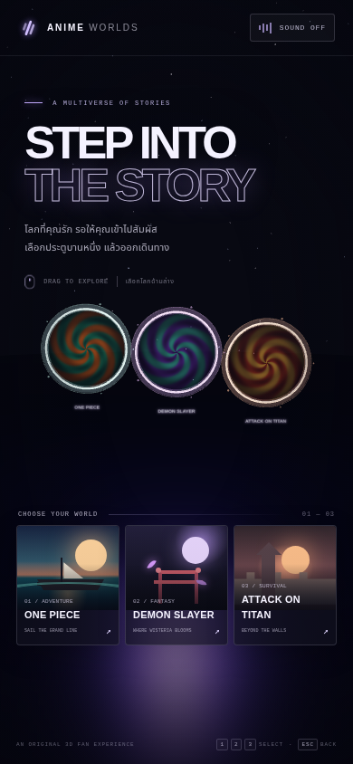

# Anime Worlds

ประสบการณ์สำรวจโลก 3D ด้วย Three.js เริ่มจากฮับพอร์ทัล แล้วเลือกเดินทางไปยังฉากที่ได้แรงบันดาลใจจากอนิเมะดังสามเรื่อง

## ภาพตัวอย่างแต่ละฟีเจอร์

### ฮับพอร์ทัลและตัวเลือกโลก



### โลก One Piece — ทะเลและเรือกลางแสงอาทิตย์


### โลก Demon Slayer — ประตูและป่าวิสทีเรียยามค่ำคืน


### โลก Attack on Titan — เมืองและกำแพงยามอาทิตย์ตก


### เลย์เอาต์สำหรับมือถือ



## ฟีเจอร์

- ฉาก WebGL 3D ที่สร้างขึ้นในเบราว์เซอร์ พร้อมแสง สี หมอก และภาพเคลื่อนไหว
- พอร์ทัลสามโลกและฉากเฉพาะของ One Piece, Demon Slayer และ Attack on Titan
- เลือกโลกจากการ์ด กดพอร์ทัล หรือกดปุ่ม `1`, `2`, `3`
- ลากเพื่อมองรอบฮับ และแตะ/คลิกจุดสำคัญในแต่ละโลกเพื่อดูรายละเอียด
- กลับฮับด้วยปุ่มกลับหรือ `Esc`; เปิด/ปิดเสียงเอฟเฟกต์สังเคราะห์ได้
- รองรับหน้าจอมือถือและการลดภาพเคลื่อนไหวตามการตั้งค่าของอุปกรณ์

## เริ่มใช้งาน

ต้องมี Node.js 20.19+ หรือ 22.12+ และ npm

```bash
npm ci --cache /tmp/anime-worlds-npm-cache --no-audit --no-fund
npm run dev
```

เปิดพอร์ต `5173` ในหน้าพรีวิวของสภาพแวดล้อม หรือเปิด URL ที่ Vite แสดงใน terminal สคริปต์ dev จะ bind ที่ `0.0.0.0:5173` เพื่อให้ cloud preview เข้าถึงได้ และจะไม่ย้ายพอร์ตเงียบ ๆ หากพอร์ตนี้ถูกใช้อยู่

ถ้าพอร์ต `5173` ถูกใช้อยู่ ให้หยุดเซิร์ฟเวอร์เดิมก่อน หรือเลือกพอร์ตอื่นแล้วเปิดพอร์ตเดียวกันใน cloud preview:

```bash
npm run dev -- --port 5174 --strictPort
```

สร้าง production build และรันพรีวิวได้ด้วย:

```bash
npm run build
npm run preview
```

## ข้อสังเกตเกี่ยวกับงานภาพ

ฉากและโมเดล 3D สร้างแบบ procedural ในโปรเจกต์ และเป็นงานแฟนอาร์ตที่ได้แรงบันดาลใจจากชื่อเรื่อง ไม่มีภาพ ตัวละคร โมเดล หรือเพลงทางการของเจ้าของลิขสิทธิ์ หากจะเผยแพร่เชิงพาณิชย์ ควรขออนุญาตใช้ทรัพย์สินทางปัญญาที่เกี่ยวข้องก่อน
