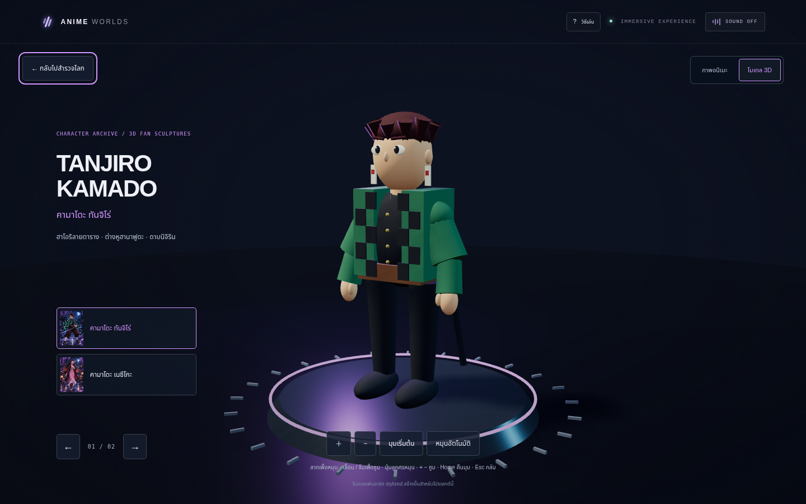
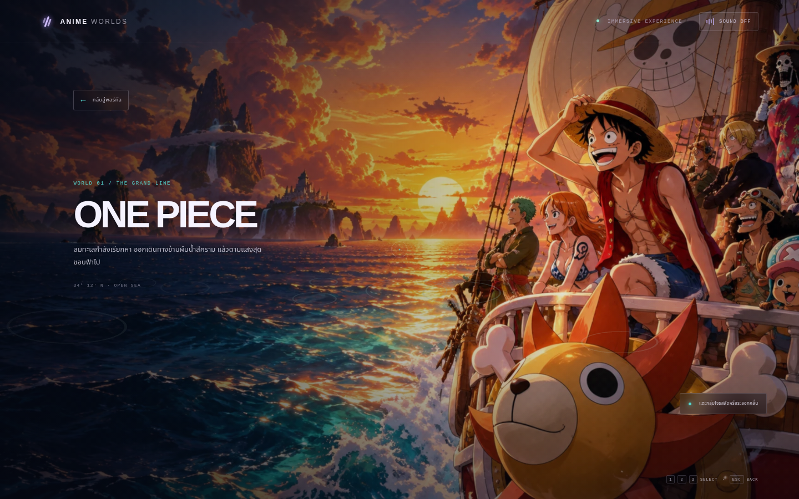
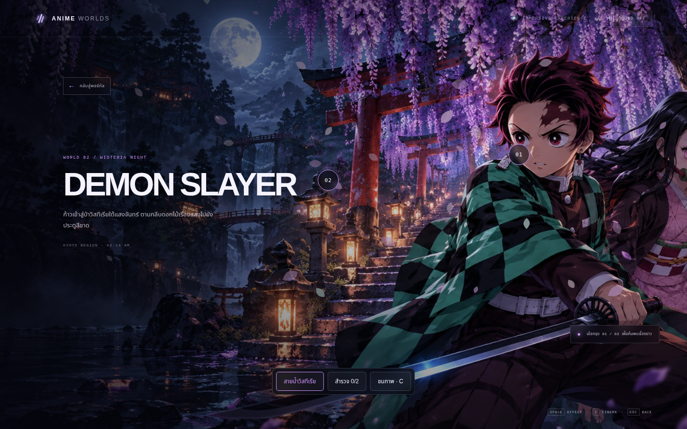
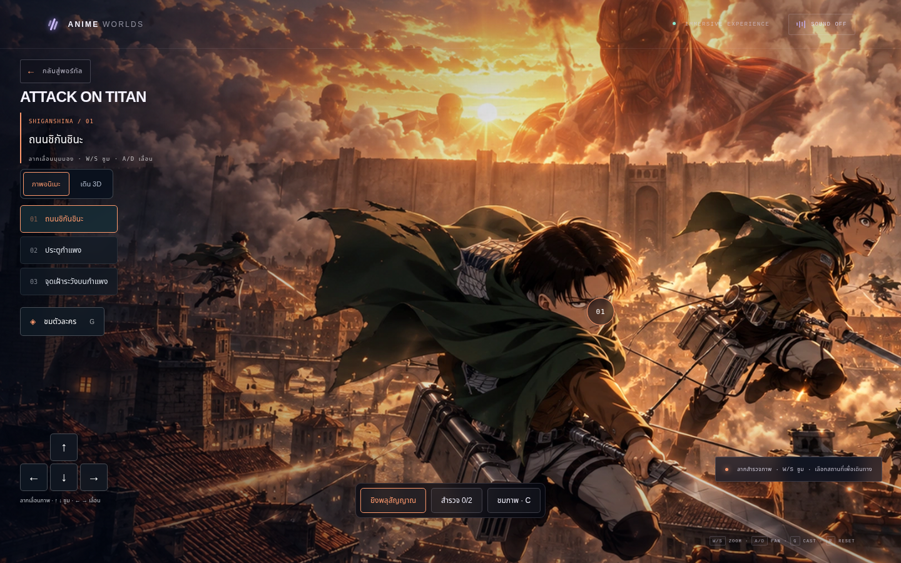
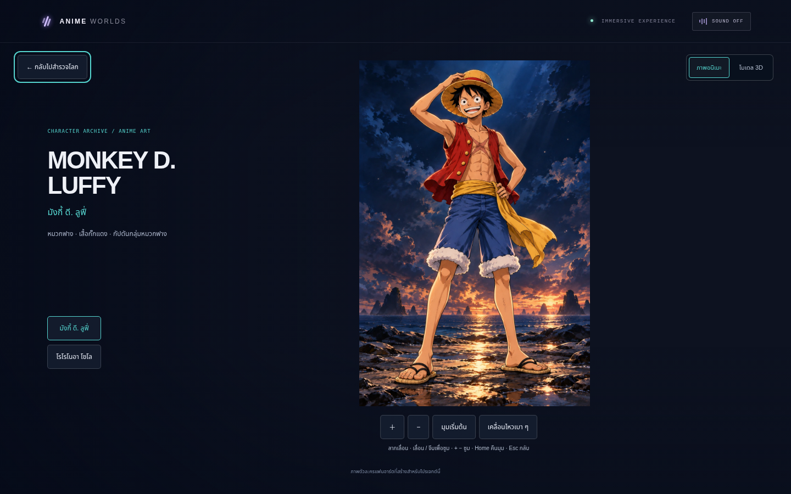
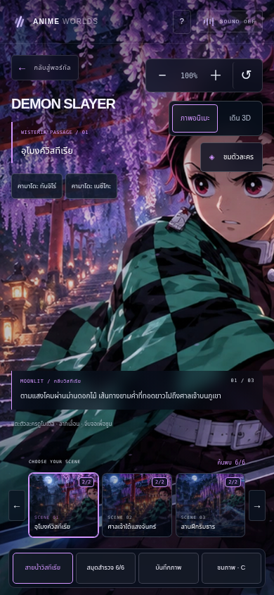

# Anime Worlds

ประสบการณ์ Three.js ที่เปิดด้วย **ภาพอนิเมะรายละเอียดสูงแบบเดิม** เป็นค่าเริ่มต้น เลือกสำรวจได้ 9 ซีน พร้อมภาพตัวละคร 6 ตัวให้ซูมและเลื่อนชม และยังสลับไปเดินสำรวจฉาก 3D หรือหมุนโมเดลรอบตัวได้

ผลตรวจไฟล์ลูฟี่ที่อัปโหลดล่าสุด พร้อมภาพเต็มตัว/ใบหน้า/ด้านข้าง/ด้านหลังและกระพริบตา: [ผลวิเคราะห์และแผนนำเข้า](docs/model-reviews/uploaded-luffy/README.md) ขณะนี้เป็นผลประเมิน ยังไม่ได้แทนโมเดลที่แอปใช้งาน

## โมเดล 3D ชุดใหม่

ปั้นแฟนโมเดลทั้ง 6 คนใหม่ใน Blender จากฐานสัดส่วนมนุษย์ MakeHuman CC0 เพิ่มใบหน้า หู มือและนิ้ว ผมหลายชั้น เสื้อผ้าโค้งที่มีรอยพับ ลายผ้า ดวงตาที่มีม่านตา และอุปกรณ์เฉพาะตัว ใช้โมเดลเดียวกันทั้งในโลกและห้องแสดง

- ห้องแสดงมีแสงสะท้อน วัสดุ PBR เงาใต้เท้า และแสงให้เลือก 3 แบบ
- เลือกมุมเต็มตัว / ใบหน้า / ด้านหลัง แล้วหมุนและซูมต่อได้ กล้องจัดกรอบตามพื้นที่บนมือถือและแนวนอน
- โหลด GLB และตัวโหลดเมื่อเลือก 3D มีสถานะโหลด ลองใหม่ และยกเลิกคำขอเก่าเมื่อเปลี่ยนตัวละคร
- ฉากทั้งสามปรับผิวไม้ หิน ทราย ให้มี bump detail และเพิ่มแสงสะท้อนตามมุมมองบนผิวน้ำ

เปิดโลก → **ชมตัวละคร** → **โมเดล 3D** แล้วเลือกเต็มตัว ใบหน้า ด้านหลัง หรือเปลี่ยนแสงได้ทันที



| ตัวละคร | เต็มตัว | รายละเอียดใบหน้า | ด้านหลัง |
| --- | --- | --- | --- |
| ลูฟี่ | [ดู](docs/screenshots/model-luffy.png) | [ดู](docs/screenshots/model-face-luffy.png) | [ดู](docs/screenshots/model-back-luffy.png) |
| โซโล | [ดู](docs/screenshots/model-zoro.png) | [ดู](docs/screenshots/model-face-zoro.png) | [ดู](docs/screenshots/model-back-zoro.png) |
| ทันจิโร่ | [ดู](docs/screenshots/model-tanjiro.png) | [ดู](docs/screenshots/model-face-tanjiro.png) | [ดู](docs/screenshots/model-back-tanjiro.png) |
| เนซึโกะ | [ดู](docs/screenshots/model-nezuko.png) | [ดู](docs/screenshots/model-face-nezuko.png) | [ดู](docs/screenshots/model-back-nezuko.png) |
| รีไวล์ | [ดู](docs/screenshots/model-levi.png) | [ดู](docs/screenshots/model-face-levi.png) | [ดู](docs/screenshots/model-back-levi.png) |
| มิคาสะ | [ดู](docs/screenshots/model-mikasa.png) | [ดู](docs/screenshots/model-face-mikasa.png) | [ดู](docs/screenshots/model-back-mikasa.png) |

[มือถือ](docs/screenshots/sculpture-390x844.png) · [จอเล็ก 320 พิกเซล](docs/screenshots/sculpture-320x740.png) · [แนวนอน](docs/screenshots/sculpture-844x390.png) · [ตัวอย่างแสงจันทร์](docs/screenshots/studio-light-1.png) · [ที่มาและสิทธิ์ของฐานโมเดล](scripts/model-source/README.md)

## เก็บงานทุกโลก

- แถบเลือกซีนมีภาพตัวอย่าง ปุ่มก่อนหน้า/ถัดไป และจำนวนจุดที่ค้นพบของแต่ละซีน
- เรื่องราวเฉพาะ 18 จุด แยกซีนละ 2 จุด พร้อมสมุดสำรวจที่จำความคืบหน้าเดิมและพาเดินทางไปแต่ละซีนได้
- เปลี่ยนภาพอย่างนุ่มนวล เพิ่มละอองทะเล กลีบวิสทีเรีย และประกายอำพัน โดยหยุดการเคลื่อนไหวอัตโนมัติเมื่อใช้ reduced motion
- จีบซูมฉาก ดับเบิลคลิกขยาย และเลื่อนดูได้ทั่วภาพบนมือถือ; ภาพตัวละครที่ซูมเข้าเลื่อนชมได้ตั้งแต่หัวถึงเท้า
- หน้าชมตัวละครมีภาพย่อ ปุ่มก่อนหน้า/ถัดไป และปุ่มลัด `[ ]`
- “บันทึกภาพ” ส่งออกมุมที่กำลังชมเป็น PNG โดยไม่รวมเมนู
- ปุ่ม `?` เปิดวิธีเล่นและเลือกคุณภาพ อัตโนมัติ / เน้นความลื่น / เน้นความคมชัด โดยจำตัวเลือกไว้บนอุปกรณ์
- โหมดภาพไม่สร้าง geometry ฉาก 3D ล่วงหน้า ฉากและห้องโมเดลจะสร้างเมื่อเลือกใช้

## โลกและพื้นที่สำรวจ

| โลก | จุดเดินทางที่เชื่อมกัน | ตัวละครในห้องโมเดล |
| --- | --- | --- |
| One Piece | ดาดฟ้าเรือ → ท่าเรือหมวกฟาง → ชายหาดลับ | ลูฟี่ / โซโล |
| Demon Slayer | อุโมงค์วิสทีเรีย → ศาลเจ้าใต้แสงจันทร์ → ลานฝึกริมธาร | ทันจิโร่ / เนซึโกะ |
| Attack on Titan | ถนนชิกันชินะ → ประตูกำแพง → จุดเฝ้าระวังบนกำแพง | รีไวล์ / มิคาสะ |

**ภาพอนิเมะ**: ลากหรือ A/D เลื่อนมุมภาพ, W/S หรือล้อเมาส์ซูม, เลือกสถานที่เพื่อเปลี่ยนฉาก มี parallax เบา ๆ จุดสำรวจและเอฟเฟกต์ประจำโลก ใช้ภาพเดิม 3 ภาพและเพิ่มภาพสถานที่ใหม่ 6 ภาพ โดยคงลุค สี และรายละเอียดของภาพวาด

**เดิน 3D**: เลือกปุ่มเดิน 3D แล้วใช้ WASD/Shift และลากมองรอบตัว มีแผนที่ ขอบเขตและสิ่งกีดขวาง ทางลาดเดินขึ้นกำแพงสูง 9 เมตรได้ โหมดภาพอนิเมะเป็นการสำรวจภาพแบบ 2.5D ที่มีขอบเขต ส่วนการเดินอิสระและหมุนมอง 360° อยู่ในโหมด 3D

## ภาพหน้าจอจริง

### One Piece



[ท่าเรือ](docs/screenshots/one-piece-scene-2.png) · [ชายหาดลับ](docs/screenshots/one-piece-scene-3.png) · [เอฟเฟกต์ลมทะเล](docs/screenshots/one-piece-action.png)

### Demon Slayer



[ศาลเจ้า](docs/screenshots/demon-slayer-scene-2.png) · [ลานฝึกริมธาร](docs/screenshots/demon-slayer-scene-3.png) · [เอฟเฟกต์สายน้ำ](docs/screenshots/demon-slayer-action.png)

### Attack on Titan



[ประตูกำแพง](docs/screenshots/attack-on-titan-scene-2.png) · [จุดชมเมืองบนกำแพง](docs/screenshots/attack-on-titan-scene-3.png) · [เอฟเฟกต์พลุสัญญาณ](docs/screenshots/attack-on-titan-action.png)

### ห้องชมตัวละคร



เริ่มด้วยภาพอนิเมะตัวละครเต็มตัว เลือกทีละคน ลากเลื่อน ซูมด้วยล้อเมาส์/จีบจอหรือปุ่ม และเลือกเคลื่อนไหวเบา ๆ ได้ ปุ่ม “โมเดล 3D” เปิดแฟนโมเดลชุดใหม่เพื่อหมุนรอบตัวและเลือกมุมรายละเอียด เมื่อกลับไปสำรวจจะคืนตำแหน่งเดิม

| One Piece | Demon Slayer | Attack on Titan |
| --- | --- | --- |
| [ลูฟี่](docs/screenshots/portrait-luffy.png) | [ทันจิโร่](docs/screenshots/portrait-tanjiro.png) | [รีไวล์](docs/screenshots/portrait-levi.png) |
| [โซโล](docs/screenshots/portrait-zoro.png) | [เนซึโกะ](docs/screenshots/portrait-nezuko.png) | [มิคาสะ](docs/screenshots/portrait-mikasa.png) |

### มือถือและเครื่องมือเดิม



[ชมตัวละครบนมือถือ](docs/screenshots/mobile-gallery.png) · [ฉากแนวนอน](docs/screenshots/landscape-world.png) · [ชมตัวละครแนวนอน](docs/screenshots/landscape-gallery.png) · [สมุดสำรวจ](docs/screenshots/field-notes.png) · [ซ่อน UI](docs/screenshots/cinematic.png) · [ฮับพอร์ทัล](docs/screenshots/hub.png)

ดู [ตัวอย่างโหมดเดิน 3D](docs/screenshots/3d-one-piece.png), [ตัวละครใหม่ที่อยู่ในโลก](docs/screenshots/3d-one-piece-action.png) และ [โมเดลรอบตัว](docs/screenshots/model-luffy.png) ได้จากปุ่มสลับโหมด

## การควบคุม

| การทำงาน | คอมพิวเตอร์ | มือถือ |
| --- | --- | --- |
| ภาพอนิเมะ: เลื่อน / ซูม | ลากหรือ A/D / W/S หรือล้อเมาส์; ดับเบิลคลิกขยาย | ลากจอ / จีบจอ / ปุ่ม + − |
| เดิน 3D / มองรอบตัว | เลือกเดิน 3D, WASD/Shift / ลากหรือปุ่มลูกศร | ปุ่มลูกศรค้าง / ลากด้วยนิ้วที่สอง |
| เปลี่ยนจุดสำรวจ | ภาพย่อ 01–03 / ปุ่มก่อนหน้า–ถัดไป / `[ ]` | แตะภาพตัวอย่างหรือปุ่มลูกศรข้างแถบ |
| กลับจุดเริ่มของซีน | R | แตะชื่อสถานที่เดิม |
| ชมตัวละคร | G / ปุ่มชมตัวละคร | ปุ่มชมตัวละคร |
| หมุน / ซูมโมเดล | ลาก / ล้อเมาส์; ลูกศร / + − | ลาก / จีบจอ / ปุ่มซูม |
| คืนมุมโมเดล | Home / มุมเริ่มต้น | มุมเริ่มต้น |
| เอฟเฟกต์ประจำโลก | Space / ปุ่มเอฟเฟกต์ | ปุ่มเอฟเฟกต์ |
| ซ่อน UI / บันทึกมุม | C / ปุ่มบันทึกภาพ | ปุ่มชมภาพ / บันทึกภาพ |
| วิธีเล่นและคุณภาพภาพ | `?` / ปุ่มวิธีเล่นด้านบน | ปุ่ม ? |
| กลับ | Esc ปิดสมุด/ห้องโมเดล/โหมดชมภาพก่อนกลับฮับ | ปุ่มกลับแต่ละโหมด |

รองรับ reduced motion โดยหยุดน้ำ/อนุภาค/การหมุนอัตโนมัติ กล้องยังตอบสนองต่อคำสั่งผู้ใช้ สมุดสำรวจจำความคืบหน้าบนอุปกรณ์แบบ best-effort และปุ่มเสียงควบคุมเสียงสังเคราะห์เดิม

## เริ่มใช้งาน

ต้องมี Node.js 20.19+ หรือ 22.12+ และ npm

```bash
npm ci --cache /tmp/anime-worlds-npm-cache --no-audit --no-fund
npm run dev
```

เปิดพอร์ต `5173` ในหน้าพรีวิวของสภาพแวดล้อม หรือเปิด URL ที่ Vite แสดงใน terminal สคริปต์ dev จะ bind ที่ `0.0.0.0:5173` เพื่อให้ cloud preview เข้าถึงได้ และจะไม่ย้ายพอร์ตเงียบ ๆ หากพอร์ตนี้ถูกใช้อยู่

ถ้าพอร์ต `5173` ถูกใช้อยู่ ให้หยุดเซิร์ฟเวอร์เดิมก่อน หรือเลือกพอร์ตอื่นแล้วเปิดพอร์ตเดียวกันใน cloud preview:

```bash
npm run dev -- --port 5174 --strictPort
```

สร้าง production build และรันพรีวิวได้ด้วย:

```bash
npm run build
npm run preview
```

## ตรวจสอบด้วยเบราว์เซอร์

```bash
npm run test:navigation  # ขอบเขตเดินและเส้นทาง 4 ชุด
npm run test:journal     # ข้อมูลเก่า ความคืบหน้า และกรณี storage ใช้ไม่ได้ 4 ชุด
npm run test:viewport    # เลื่อนทั่วภาพ ขอบว่าง และขอบเขตภาพตัวละคร 4 ชุด
npm run test:polish      # ใช้ Chromium ตรวจคลิกจริง PNG คุณภาพภาพ pinch และจอเล็ก
npm run test:models      # ตรวจ GLB ทั้ง 6: geometry, normals, ขนาด และ texture
npm run test:models:browser # โมเดล/มุมชม/แสง/มือถือ/โหลดผิดพลาด/ลองใหม่/คำขอเก่า
```

การทดสอบ TypeScript แบบไม่ build ใช้ Node.js 22.18+ หรือ 24

`npm run test:navigation` ตรวจเส้นทางที่เชื่อมกัน ขอบทะเล สะพาน ทางลาดและสิ่งกีดขวาง 4 ชุดทดสอบ (Node.js 22.18+ หรือ Node.js 24)

`npm run test:browser` ใช้ Node.js 22+ และ Chromium ที่เปิด Chrome DevTools Protocol ไว้ เช่นใน cloud Linux:

```bash
chromium --headless=new --no-sandbox --disable-dev-shm-usage --enable-unsafe-swiftshader --use-gl=angle --use-angle=swiftshader-webgl --user-data-dir=/tmp/anime-worlds-chrome --remote-debugging-port=9223 --remote-allow-origins='*' about:blank
```

จากอีก terminal ที่รันแอปไว้แล้ว:

```bash
npm run test:browser
# ทดสอบ production preview และบันทึกภาพหน้าจอ
APP_URL=http://127.0.0.1:4173 SCREENSHOT_DIR=/tmp/anime-checks npm run test:browser
```

สคริปต์ตรวจว่าโหมดภาพอนิเมะเป็นค่าเริ่มต้น, โหลดภาพตรงกับสถานที่ทั้ง 9 ซีน, เลื่อน/ซูมภาพและภาพตัวละคร 6 คน, สลับโหมดภาพ/3D, เดิน/มอง/คืนมุม, ทางลาดและความสูง, โมเดลทั้ง 6 ตัว, orbit/zoom/หมุนอัตโนมัติ, คืนตำแหน่งหลังออกจาก gallery, คืน geometry หลังออกจากโลก, สมุดสำรวจ/เอฟเฟกต์, สองนิ้วเดินพร้อมมอง, retina/แนวนอน/reduced motion, ยกเลิกการเปลี่ยนโลกแล้วลองใหม่ ภาพที่มาช้าไม่ทับซีนใหม่, timeout/ลองโหลดภาพใหม่ สมุดสำรวจ 18 จุด, ฉาก 3D ที่สร้างเมื่อเลือกใช้ และสลับไปเดิน 3D ได้แม้ภาพอนิเมะโหลดไม่สำเร็จ การวัด FPS บนอุปกรณ์จริงยังอยู่ในแผนระยะถัดไป

## ที่มาของโมเดลและวัสดุ

ภาพอนิเมะทั้งฉากและภาพตัวละครเป็นแฟนอาร์ต AI ที่สร้างขึ้นสำหรับโปรเจกต์นี้ ภาพสถานที่ใหม่มีขนาดต้นฉบับ 1672×941, ภาพตัวละคร 1024×1536 และไฟล์ใหม่ทั้งหมดประมาณ 6 MB โหลดเฉพาะซีน/ตัวละครที่เลือก

ฉาก 3D สร้างด้วย Three.js ใน [src/immersive](src/immersive) วัสดุไม้ หิน ทราย และท้องฟ้าสร้างในเครื่อง ส่วนตัวละครโหลดจาก GLB ใน `public/models` พร้อม texture ที่ฝังในไฟล์ ไม่เรียก CDN ภายนอก ดูที่มา ขนาด และข้อจำกัดใน [asset manifest](docs/ASSETS.md)

การสร้างโมเดลซ้ำใช้ Blender 4.3+ และ `npm run models:build` โดยมี source และ license ของฐานสัดส่วนเก็บใน repository แล้ว การเปิดเว็บตามปกติไม่ต้องติดตั้ง Blender

รายละเอียดภาพเดิม ภาพสถานที่และภาพตัวละคร พร้อม manifest อยู่ใน [public/artwork/README.md](public/artwork/README.md) ภาพวาดไม่ใช่เฟรมหรือโมเดลทางการจากอนิเมะ โมเดล 3D ใหม่เป็นแฟนโมเดลที่ใช้สัดส่วนมนุษย์และปรับลุคอนิเมะ มี geometry รอบตัวจริง แต่ยังเป็นประติมากรรมท่าคงที่ ไม่มี skeletal animation และไม่ใช่โมเดลทางการ ชื่อเรื่อง/ตัวละครเป็นของผู้ถือสิทธิ์ต้นฉบับ

ดู [หน้าวิธีเล่น](docs/screenshots/controls-guide.png) · [หน้าจอมือถือ](docs/screenshots/mobile-immersive.png)

รายละเอียดการทำงานและสิ่งที่ยังเหลือ: [แผนเก็บงาน](docs/POLISH_PLAN.md)
