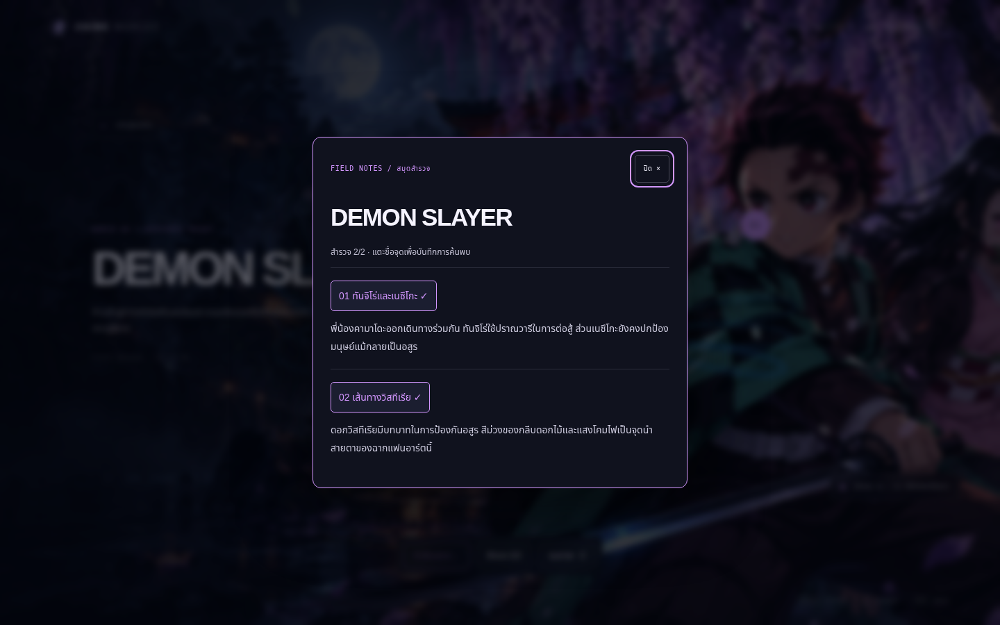

# Anime Worlds

ประสบการณ์ด้วย Three.js เริ่มจากฮับพอร์ทัล 3D แล้วเดินทางไปยังภาพฉากแบบ 2.5D ที่ซ้อนเอฟเฟกต์และอนุภาค 3D จากอนิเมะดังสามเรื่อง

ดู [แผนเก็บงานและแผนต่อยอดรายโลก](docs/POLISH_PLAN.md) สำหรับสิ่งที่ทำในรอบนี้ เกณฑ์ตรวจสอบ และขอบเขตฉาก/โมเดล 3D ในระยะถัดไป

## ภาพตัวอย่างแต่ละฟีเจอร์

### ฮับพอร์ทัลและตัวเลือกโลก


### โลก One Piece — กลุ่มหมวกฟางบนแกรนด์ไลน์


ลูกเล่น: เรียกลมทะเลเป็นวงลมและละอองน้ำ — [ภาพขณะเล่นเอฟเฟกต์](docs/screenshots/one-piece-action.png)

### โลก Demon Slayer — ประตูและป่าวิสทีเรียยามค่ำคืน


ลูกเล่น: ริบบิ้นสายน้ำพร้อมกลีบวิสทีเรีย — [ภาพขณะเล่นเอฟเฟกต์](docs/screenshots/demon-slayer-action.png)

### โลก Attack on Titan — เมืองและกำแพงยามอาทิตย์ตก


ลูกเล่น: พลุสัญญาณสีเขียวพุ่งขึ้นพร้อมควัน — [ภาพขณะเล่นเอฟเฟกต์](docs/screenshots/attack-on-titan-action.png)

### สมุดสำรวจและโหมดชมภาพ



[ภาพในโหมดซ่อน UI](docs/screenshots/cinematic.png)

### เลย์เอาต์สำหรับมือถือ


[ภาพฮับในแนวนอน](docs/screenshots/landscape-hub.png)

## ฟีเจอร์

- ภาพฉาก cinematic แบบเต็มจอ พร้อมกลีบวิสทีเรีย ระลอกน้ำ และฝุ่นอำพันที่ลอยเป็นเลเยอร์ 3D
- พอร์ทัลสามโลกและฉากเฉพาะของ One Piece, Demon Slayer และ Attack on Titan
- เลือกโลกจากการ์ด กดพอร์ทัล หรือกดปุ่ม `1`, `2`, `3`
- ลาก/เลื่อนเมาส์หรือใช้นิ้วเพื่อขยับภาพแบบ parallax ที่ปรับอย่างนุ่มนวล
- แตะจุด `01` / `02` หรือเปิดสมุดสำรวจเพื่ออ่านรายละเอียดและเก็บ progress แยกโลกบนอุปกรณ์
- ปุ่มลูกเล่นประจำโลกหรือ `Space` ขณะโฟกัสฉาก; ปุ่ม `C` เปิด/ปิดโหมดชมภาพ
- กลับฮับด้วยปุ่มกลับหรือ `Esc`; เปิด/ปิดเสียงเอฟเฟกต์สังเคราะห์ได้
- `Esc` ปิดสมุดสำรวจก่อน; ในโหมดชมภาพ `Esc` จะแสดง UI กลับมา
- รองรับมือถือ/แนวนอน/retina และ reduced motion; หากโหลดภาพไม่สำเร็จจะกลับฮับและลองใหม่ได้

## เริ่มใช้งาน

ต้องมี Node.js 20.19+ หรือ 22.12+ และ npm

```bash
npm ci --cache /tmp/anime-worlds-npm-cache --no-audit --no-fund
npm run dev
```

เปิดพอร์ต `5173` ในหน้าพรีวิวของสภาพแวดล้อม หรือเปิด URL ที่ Vite แสดงใน terminal สคริปต์ dev จะ bind ที่ `0.0.0.0:5173` เพื่อให้ cloud preview เข้าถึงได้ และจะไม่ย้ายพอร์ตเงียบ ๆ หากพอร์ตนี้ถูกใช้อยู่

ถ้าพอร์ต `5173` ถูกใช้อยู่ ให้หยุดเซิร์ฟเวอร์เดิมก่อน หรือเลือกพอร์ตอื่นแล้วเปิดพอร์ตเดียวกันใน cloud preview:

```bash
npm run dev -- --port 5174 --strictPort
```

สร้าง production build และรันพรีวิวได้ด้วย:

```bash
npm run build
npm run preview
```

## ตรวจสอบด้วยเบราว์เซอร์

`npm run test:browser` ใช้ Node.js 22+ และ Chromium ที่เปิด Chrome DevTools Protocol ไว้ เช่นใน cloud Linux:

```bash
chromium --headless=new --no-sandbox --disable-dev-shm-usage --enable-unsafe-swiftshader --use-gl=angle --use-angle=swiftshader-webgl --user-data-dir=/tmp/anime-worlds-chrome --remote-debugging-port=9223 --remote-allow-origins='*' about:blank
```

จากอีก terminal ที่รันแอปไว้แล้ว:

```bash
npm run test:browser
# ทดสอบ production preview และบันทึกภาพหน้าจอ
APP_URL=http://127.0.0.1:4173 SCREENSHOT_DIR=/tmp/anime-checks npm run test:browser
```

สคริปต์ตรวจทั้งสามโลก, action/cooldown, hotspot และสมุดสำรวจ, progress หลัง reload, cinematic, Tab/Escape, touch/retina/แนวนอน, reduced motion และจำลองภาพโหลดผิดพลาด/timeout/ยกเลิกแล้วลองใหม่ การวัด FPS บนอุปกรณ์จริงยังอยู่ในแผนระยะถัดไป

## ที่มาของงานภาพ

ภาพฉากทั้งสามเป็น fan art ที่สร้างขึ้นใหม่ด้วย AI สำหรับโปรเจกต์นี้ ไม่ได้ scrape เฟรมอนิเมะ ภาพโปรโมต หรือผลงานจากเว็บ ฉากภาพประกอบมีเลเยอร์วัตถุและ hotspot 3D ที่สร้างด้วย Three.js ภาพและตัวละครไม่ใช่งานทางการของเจ้าของลิขสิทธิ์; ชื่อเรื่องและตัวละครเป็นทรัพย์สินของผู้ถือสิทธิ์ ดูรายละเอียดได้ที่ [public/artwork/README.md](public/artwork/README.md) โปรเจกต์นี้ไม่มีการรับรองจากผู้ถือสิทธิ์ และควรตรวจสอบสิทธิ์ก่อนเผยแพร่หรือใช้เชิงพาณิชย์
