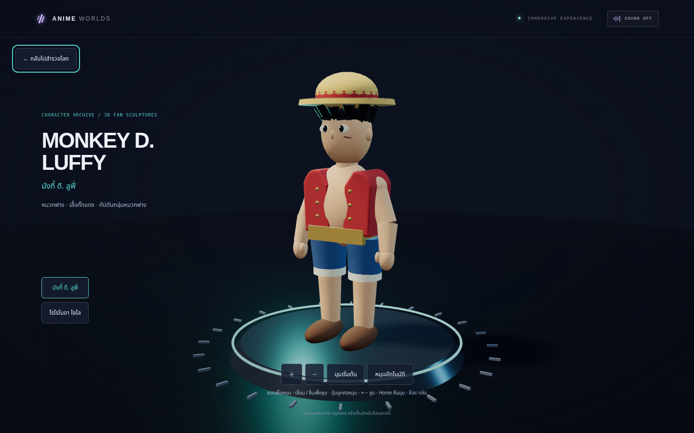

# Anime Worlds

เว็บ Three.js สำหรับเดินสำรวจพื้นที่ **3D จริง** ในสามโลกอนิเมะ มีจุดเดินทาง 9 จุดและห้องชมตัวละครทีละโมเดล 6 ตัว ฉากและตัวละครเป็นแฟนโมเดล stylized ที่สร้างด้วย geometry ไม่ใช่ภาพตัวละครบนแผ่น plane

## โลกและพื้นที่สำรวจ

| โลก | จุดเดินทางที่เชื่อมกัน | ตัวละครในห้องโมเดล |
| --- | --- | --- |
| One Piece | ดาดฟ้าเรือ → ท่าเรือหมวกฟาง → ชายหาดลับ | ลูฟี่ / โซโล |
| Demon Slayer | อุโมงค์วิสทีเรีย → ศาลเจ้าใต้แสงจันทร์ → ลานฝึกริมธาร | ทันจิโร่ / เนซึโกะ |
| Attack on Titan | ถนนชิกันชินะ → ประตูกำแพง → จุดเฝ้าระวังบนกำแพง | รีไวล์ / มิคาสะ |

เดินด้วย WASD และลากเพื่อมองรอบตัวได้ต่อเนื่อง ปุ่มเลือกสถานที่ช่วยกระโดดไปจุดสำคัญ แผนที่แสดงตำแหน่งและทิศทาง มีขอบเขตพื้นที่และสิ่งกีดขวางสำหรับเรือ อาคาร ต้นไม้ และลำธาร ทางลาดของเมืองพาเดินขึ้นกำแพงสูง 9 เมตรได้ ฉากเป็นการตีความสำหรับโปรเจกต์ ไม่ใช่แผนที่จำลองจากต้นฉบับแบบตรงสเกล

## ภาพหน้าจอจริง

### One Piece


[ท่าเรือ](docs/screenshots/one-piece-scene-2.png) · [ชายหาดลับ](docs/screenshots/one-piece-scene-3.png) · [เอฟเฟกต์ลมทะเล](docs/screenshots/one-piece-action.png)

### Demon Slayer


[ศาลเจ้า](docs/screenshots/demon-slayer-scene-2.png) · [ลานฝึกริมธาร](docs/screenshots/demon-slayer-scene-3.png) · [เอฟเฟกต์สายน้ำ](docs/screenshots/demon-slayer-action.png)

### Attack on Titan


[ประตูกำแพง](docs/screenshots/attack-on-titan-scene-2.png) · [จุดชมเมืองบนกำแพง](docs/screenshots/attack-on-titan-scene-3.png) · [เอฟเฟกต์พลุสัญญาณ](docs/screenshots/attack-on-titan-action.png)

### ห้องชมโมเดลตัวละคร



เลือกตัวละครทีละตัว หมุนดูรอบตัวด้วยเมาส์หรือนิ้ว ซูมด้วยล้อเมาส์/จีบจอหรือปุ่ม และเลือกหมุนอัตโนมัติได้ เมื่อกลับไปสำรวจ กล้องจะคืนตำแหน่งและมุมเดิม

| One Piece | Demon Slayer | Attack on Titan |
| --- | --- | --- |
| [ลูฟี่](docs/screenshots/model-luffy.png) | [ทันจิโร่](docs/screenshots/model-tanjiro.png) | [รีไวล์](docs/screenshots/model-levi.png) |
| [โซโล](docs/screenshots/model-zoro.png) | [เนซึโกะ](docs/screenshots/model-nezuko.png) | [มิคาสะ](docs/screenshots/model-mikasa.png) |

### มือถือและเครื่องมือเดิม


[ห้องโมเดลบนมือถือ](docs/screenshots/mobile-gallery.png) · [ฉากแนวนอน](docs/screenshots/landscape-world.png) · [โมเดลแนวนอน](docs/screenshots/landscape-gallery.png) · [สมุดสำรวจ](docs/screenshots/field-notes.png) · [ซ่อน UI](docs/screenshots/cinematic.png) · [ฮับพอร์ทัล](docs/screenshots/hub.png)

## การควบคุม

| การทำงาน | คอมพิวเตอร์ | มือถือ |
| --- | --- | --- |
| เดิน | WASD; Shift เร่ง | กดปุ่มลูกศรค้าง |
| มองรอบตัว | ลากฉาก / ปุ่มลูกศร | ลากฉาก ใช้นิ้วที่สองมองขณะเดินได้ |
| เปลี่ยนจุดสำรวจ | ปุ่ม 01–03 | แตะชื่อสถานที่ |
| กลับจุดเริ่มของซีน | R | แตะชื่อสถานที่เดิม |
| ชมตัวละคร | G / ปุ่มชมโมเดล | ปุ่มชมโมเดล |
| หมุน / ซูมโมเดล | ลาก / ล้อเมาส์; ลูกศร / + − | ลาก / จีบจอ / ปุ่มซูม |
| คืนมุมโมเดล | Home / มุมเริ่มต้น | มุมเริ่มต้น |
| เอฟเฟกต์ประจำโลก | Space / ปุ่มเอฟเฟกต์ | ปุ่มเอฟเฟกต์ |
| ซ่อน UI | C | ปุ่มชมภาพ |
| กลับ | Esc ปิดสมุด/ห้องโมเดล/โหมดชมภาพก่อนกลับฮับ | ปุ่มกลับแต่ละโหมด |

รองรับ reduced motion โดยหยุดน้ำ/อนุภาค/การหมุนอัตโนมัติ กล้องยังตอบสนองต่อคำสั่งผู้ใช้ สมุดสำรวจจำความคืบหน้าบนอุปกรณ์แบบ best-effort และปุ่มเสียงควบคุมเสียงสังเคราะห์เดิม

## เริ่มใช้งาน

ต้องมี Node.js 20.19+ หรือ 22.12+ และ npm

```bash
npm ci --cache /tmp/anime-worlds-npm-cache --no-audit --no-fund
npm run dev
```

เปิดพอร์ต `5173` ในหน้าพรีวิวของสภาพแวดล้อม หรือเปิด URL ที่ Vite แสดงใน terminal สคริปต์ dev จะ bind ที่ `0.0.0.0:5173` เพื่อให้ cloud preview เข้าถึงได้ และจะไม่ย้ายพอร์ตเงียบ ๆ หากพอร์ตนี้ถูกใช้อยู่

ถ้าพอร์ต `5173` ถูกใช้อยู่ ให้หยุดเซิร์ฟเวอร์เดิมก่อน หรือเลือกพอร์ตอื่นแล้วเปิดพอร์ตเดียวกันใน cloud preview:

```bash
npm run dev -- --port 5174 --strictPort
```

สร้าง production build และรันพรีวิวได้ด้วย:

```bash
npm run build
npm run preview
```

## ตรวจสอบด้วยเบราว์เซอร์

`npm run test:navigation` ตรวจเส้นทางที่เชื่อมกัน ขอบทะเล สะพาน ทางลาดและสิ่งกีดขวาง 4 ชุดทดสอบ (Node.js 22.18+ หรือ Node.js 24)

`npm run test:browser` ใช้ Node.js 22+ และ Chromium ที่เปิด Chrome DevTools Protocol ไว้ เช่นใน cloud Linux:

```bash
chromium --headless=new --no-sandbox --disable-dev-shm-usage --enable-unsafe-swiftshader --use-gl=angle --use-angle=swiftshader-webgl --user-data-dir=/tmp/anime-worlds-chrome --remote-debugging-port=9223 --remote-allow-origins='*' about:blank
```

จากอีก terminal ที่รันแอปไว้แล้ว:

```bash
npm run test:browser
# ทดสอบ production preview และบันทึกภาพหน้าจอ
APP_URL=http://127.0.0.1:4173 SCREENSHOT_DIR=/tmp/anime-checks npm run test:browser
```

สคริปต์ตรวจ 9 จุดสำรวจ, เดิน/มอง/คืนมุม, ทางลาดและความสูง, โมเดลทั้ง 6 ตัว, orbit/zoom/หมุนอัตโนมัติ, คืนตำแหน่งหลังออกจาก gallery, คืน geometry หลังออกจากโลก, สมุดสำรวจ/เอฟเฟกต์, สองนิ้วเดินพร้อมมอง, retina/แนวนอน/reduced motion, ยกเลิกการเปลี่ยนโลกแล้วลองใหม่ และเข้าโลกได้แม้ภาพปกโหลดไม่สำเร็จ การวัด FPS บนอุปกรณ์จริงยังอยู่ในแผนระยะถัดไป

## ที่มาของโมเดลและวัสดุ

ฉาก เรือ อาคาร ต้นไม้ เสื้อผ้า ดาบ ใบหน้า และตัวละครทั้งหมดสร้างด้วย Three.js ใน [src/immersive](src/immersive) วัสดุไม้ หิน ทราย และท้องฟ้าสร้างในเครื่อง จึงไม่ต้องโหลดโมเดลหรือเรียก CDN ภายนอก ดูรายการและข้อจำกัดใน [asset manifest](docs/ASSETS.md)

ภาพปกบนหน้าฮับเป็น fan art ที่สร้างด้วย AI ตามรายละเอียดใน [public/artwork/README.md](public/artwork/README.md) ภาพปกไม่ได้ใช้แทนโลก 3D โมเดลเป็นงาน stylized ไม่มี skeletal animation และไม่ใช่โมเดลทางการหรือโมเดลสมจริงระดับเกม ชื่อเรื่อง/ตัวละครเป็นของผู้ถือสิทธิ์ต้นฉบับ

รายละเอียดการทำงานและสิ่งที่ยังเหลือ: [แผนเก็บงาน](docs/POLISH_PLAN.md)
